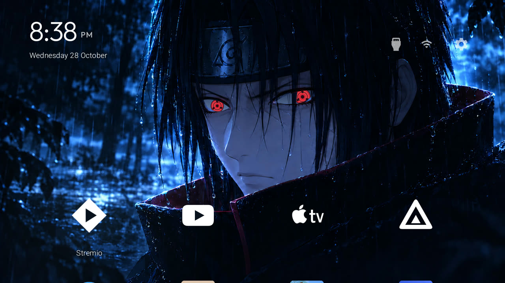

# Itachi Improved Edition

A native CleanYourTV theme with animated Sharingan eyes and a dark rainy Itachi wallpaper. It requires **this fork's launcher build**: copying the theme to an unmodified upstream build will not enable the animation.



## Features

- Eyes follow the selected app or top-right control horizontally and vertically.
- Brief spin on launcher startup and when Home becomes visible after TV wake; periodic blinking.
- Four-column app grid with vertically scrolling rows.
- White logos for Stremio, SmartTube, Apple TV and Jellyfin; other installed apps retain their own icons.
- A soft focus glow travels between apps and the Inputs, Wi-Fi and Settings controls.
- Selected top-right icon grows 20% and becomes fully opaque; others use 65% opacity.
- Date under the clock. The clock follows Android's 12/24-hour preference.
- Back opens Aerial Views when that app and its external screensaver activity are available. Its existing configuration is retained.

The launcher adds no dependencies, permissions, network access or accessibility service for these visual effects. The theme is opt-in through `"sharingan": true`.

## Setup

Clone the published edition first:

```bash
git clone --branch itachi-edition https://github.com/bigboss97lnt/cleanyourtv-itachi.git
cd cleanyourtv-itachi
```

1. Read the repository's [TV setup procedure](../../PROMPT.md), including backups, device compatibility and Home/remote checks. Do not apply someone else's debloat list to your TV.
2. Prepare the existing upstream requirements: JDK 17, Android SDK platform 34/build-tools 34.0.0, and the Python tools environment described in the [upstream README](../../README.md) and [setup procedure](../../PROMPT.md). First builds download the Gradle wrapper and declared Android dependencies.
3. Build this fork, then use the existing guarded installer. Replace `YOUR_TV_IP` below with your TV's address and authorize the ADB connection on the TV.

   ```bash
   export TV_HOST=YOUR_TV_IP
   # Keep the stock launcher enabled while checking the new Home screen.
   STOCK_LAUNCHER=none launcher/build-and-install.sh
   tools/theme.sh themes/itachi
   ```

   The build script installs the launcher and sets Home. Review its output and verify the TV's actual Home behavior before changing any stock-launcher packages. If you already use an upstream APK signed with a different key, Android may reject the update: preserve the existing installation/data and resolve signing before continuing.

4. Press Home. Test navigation, all four favorites, Inputs, Settings, held volume, and standby/wake with the physical remote. Enable the TV's 12-hour clock preference if you want AM/PM.
5. Close debugging and revoke ADB authorizations after setup, as described in [PROMPT.md](../../PROMPT.md).

The theme does not install streaming apps. Install your preferred apps separately; missing favorites are skipped. The four package names in `config.json` can be changed. Custom white logos are currently bundled only for those four named apps.

The published config omits the original TCL-specific Live TV package and Settings keycode. Configure those through the upstream options only if needed for your model.

## Customize

Copy this theme to a directory of your own before editing `config.json`, then apply it with `tools/theme.sh <theme-directory>`.

- `columns`: four by default; `single_row` is false, so apps scroll vertically.
- `dock_apps`: preferred packages in display order.
- `show_inputs_pill`, `show_network_pill`: top-right control visibility.
- `sharingan`: false disables the custom eye overlay and styling.
- `wallpaper_dim`: keep at zero for the supplied eye overlay to match its backdrop.

Glow radii are currently in `SharinganView.java`: 26% of screen width for apps and 15% for top controls (about 500/288 px at 1920 px wide). Center opacity is 28/255, fading to transparent. Changes to animation geometry, glow or custom logos require rebuilding.

## Validation and limitations

Developed and visually checked on a TCL Android TV running Android 14, with a 1920×1080 launcher surface. Vertical gaze tracking was confirmed on the physical TV. Wake handling is implemented and its receiver checked; physical standby timing can vary by firmware and still needs testing on other TVs.

The eye and foreground-hair geometry is fitted to the included 1672×941 wallpaper. Replacing/cropping the wallpaper, dimming it, or using a different aspect ratio may misalign the overlay. This is a lightweight Canvas animation, not the original animation/assets from the inspiration video. Reduced-motion system settings suppress spin and blinking. Further improvements to iris shading and eyelid compositing are welcome.

Validation command, from `launcher/`:

```bash
./gradlew --no-daemon testReleaseUnitTest lintRelease assembleRelease
```

No APK is committed; build from source. The existing 589,824-byte APK size limit is retained.

## Undo

```bash
TV_HOST=YOUR_TV_IP tools/theme.sh --reset
```

This resets theme files and styling; it does **not** restore a previously overwritten custom theme. Reapply your saved theme to restore that appearance. To return to an older launcher build, retain its APK and signing key and use your own pre-install backup. The original upstream backup/restore tools cover the changes documented in [PROMPT.md](../../PROMPT.md).

## Credits

See [CREDITS.md](CREDITS.md) for upstream, concept and artwork attribution.
